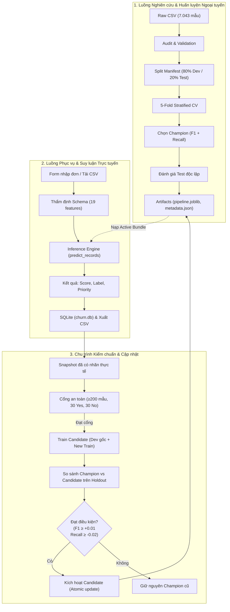
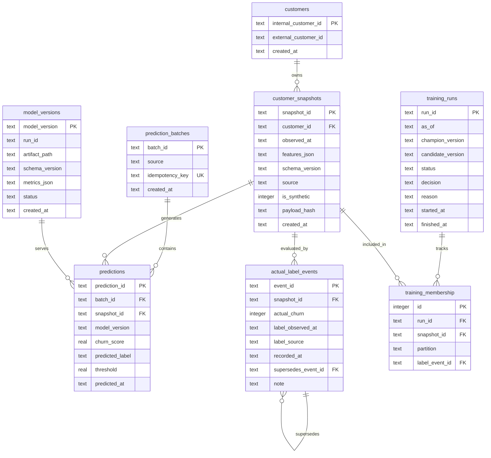

# Tài Liệu Kiến Trúc Hệ Thống & Hợp Đồng Tích Hợp (Architecture & Integration Contracts)

> **Dự án:** Dự đoán Khách hàng Rời bỏ Dịch vụ Viễn thông (Telco Customer Churn Prediction)  
> **Tài liệu căn cứ:** [Plan 04 — Kiến trúc mã nguồn và hợp đồng tích hợp](../designe-note/plans/04-kien-truc-va-tich-hop.md)  
> **Công nghệ:** Python 3.11, pandas, scikit-learn, Streamlit, SQLite3  

---

## 1. Tổng Quan Kiến Trúc Vừa Phạm Vi (Pragmatic Architecture)

Hệ thống được thiết kế theo triết lý module hóa chặt chẽ, tách biệt hoàn toàn giữa **Luồng Huấn luyện Ngoại tuyến (Offline Pipeline)**, **Luồng Phục vụ Trực tuyến (Online Serving)**, và **Chu trình Huấn luyện lại Có Kiểm soát (Controlled Retraining Loop)**. Toàn bộ logic nghiệp vụ, thẩm định dữ liệu, tiền xử lý và suy luận được đóng gói trong package Python nội bộ `telco_churn`, giúp ứng dụng giao diện Streamlit chỉ đóng vai trò giao diện hiển thị mà không chứa logic mô hình hóa phân tán.



---

## 2. Cấu Trúc Mã Nguồn Chuẩn Hóa

```text
hoc-lai/
├── app.py                         # Điểm khởi chạy ứng dụng web Streamlit
├── requirements.txt               # Danh mục thư viện cố định phiên bản
├── README.md                      # Hướng dẫn cài đặt và vận hành toàn diện
│
├── configs/
│   ├── experiment.json            # Cấu hình thử nghiệm, seed, phân chia fold
│   └── retraining.json            # Cấu hình cổng kiểm soát và tiêu chí cập nhật
│
├── src/telco_churn/               # Package lõi độc lập, tái sử dụng cao
│   ├── __init__.py                # Xuất bản hợp đồng công khai của package
│   ├── schema.py                  # Định nghĩa cột, miền giá trị, validation
│   ├── data.py                    # Nạp CSV, băm mã SHA-256, kiểm toán dữ liệu
│   ├── preprocessing.py           # Pipeline tiền xử lý scikit-learn theo từng họ mô hình
│   ├── training.py                # Grid search, CV 5-fold, lựa chọn champion
│   ├── evaluation.py              # Tính toán độ đo, confusion matrix, ROC/PR curve
│   ├── inference.py               # Nạp bundle, dự đoán batch, phân tầng ưu tiên
│   ├── storage.py                 # SQLite transaction, snapshot, audit trail
│   ├── registry.py                # Quản lý active_model.json, kiểm tra bundle, rollback
│   └── retraining.py              # Cổng kiểm soát, train candidate, so sánh holdout
│
├── ui/                            # Các phân hệ giao diện Streamlit modular
│   ├── overview.py                # Tổng quan bài toán, dữ liệu, chính sách ưu tiên
│   ├── single_prediction.py       # Form dự đoán 19 trường có ràng buộc phụ thuộc
│   ├── batch_prediction.py        # Tải CSV, thẩm định, dự đoán lô, tải kết quả
│   ├── history.py                 # Tra cứu lịch sử, cập nhật nhãn thực tế có lưu vết
│   ├── model_results.py           # Bảng so sánh CV, số liệu test, biểu đồ trực quan
│   └── model_management.py        # Trạng thái gate, chạy dry-run, demo, hoàn tác
│
├── scripts/                       # Kịch bản dòng lệnh CLI tự động hóa
│   ├── audit_data.py              # Kiểm toán tập dữ liệu gốc
│   ├── make_splits.py             # Tạo split_manifest.csv khóa 5 fold
│   ├── train.py                   # Chạy CV 5-fold và đóng gói champion
│   ├── evaluate.py                # Mở tập test 20% và tạo báo cáo cuối cùng
│   ├── init_db.py                 # Khởi tạo SQLite churn.db và nạp metadata
│   └── retrain.py                 # CLI cập nhật mô hình hàng tháng (hoặc dry-run)
│
├── data/
│   ├── splits/split_manifest.csv  # Danh sách phân chia mẫu 80/20 và fold khóa cứng
│   ├── samples/                   # CSV mẫu kiểm thử (chuẩn, lỗi schema, thiếu phí)
│   ├── snapshots/                 # Dữ liệu đóng băng phục vụ huấn luyện lại
│   └── runtime/churn.db           # Cơ sở dữ liệu SQLite thời gian thực
│
├── artifacts/
│   ├── active_model.json          # Con trỏ phiên bản active nguyên tử
│   └── models/<version>/          # Bundle độc lập: pipeline.joblib, metadata.json
│
├── reports/                       # Báo cáo và biểu đồ minh chứng khoa học
│   ├── data_audit.md              # Báo cáo kiểm toán dữ liệu
│   ├── model_selection.md         # Báo cáo chọn mô hình từ 5-Fold CV
│   ├── final_evaluation.md        # Báo cáo đánh giá tập kiểm thử
│   └── figures/                   # Biểu đồ EDA và đánh giá mô hình
│
├── docs/                          # Tài liệu kiến trúc, lý thuyết, từ điển dữ liệu
└── tests/                         # Bộ kiểm thử đơn vị tự động (pytest)
```

---

## 3. Hợp Đồng Giữa Các Module (Interface Contracts)

Bảng hợp đồng cốt lõi theo Plan 04 Section 3:

| Tên Hàm / Phương thức | Module | Đầu vào | Đầu ra & Ràng buộc giao ước |
|---|---|---|---|
| `validate_records(df, mode)` | `schema` | DataFrame thô; mode `'inference'` hoặc `'training'` | Trả về tuple `(valid_df, issues)`. Dòng hợp lệ đã chuẩn hóa kiểu dữ liệu; danh sách lỗi kèm dòng, cột, mã lỗi và thông điệp. |
| `build_preprocessor(model_kind)` | `preprocessing` | `'logistic'`, `'tree'`, hoặc `'forest'` | ColumnTransformer chưa fit, tên đặc trưng đồng nhất. |
| `load_model_bundle(version)` | `inference` | Tên phiên bản cụ thể hoặc `None` (lấy active) | Dictionary chứa `pipeline`, `metadata`, `class_1_idx`, `version`. Kiểm tra khớp schema. |
| `predict_records(df, bundle, threshold)` | `inference` | DataFrame 19 đặc trưng; model bundle; threshold tùy chọn | DataFrame kết quả chuẩn hóa: `input_row_id`, `customerID`, `churn_prediction`, `churn_label`, `churn_score`, `priority_level`, `threshold`, `model_version`, `predicted_at`. |
| `save_prediction_batch(inputs, outputs, source, ...)` | `storage` | Inputs và outputs tương ứng; nguồn (`single_form`, `csv_upload`); `idempotency_key` | Transaction nguyên tử tạo batch, snapshot bất biến và bản ghi dự đoán. Chống ghi trùng qua `idempotency_key`. |
| `record_actual_label(snapshot_id, label, observed_at, ...)` | `storage` | `snapshot_id`, nhãn thực tế (`Yes`/`No`), ngày quan sát, nguồn | Thêm sự kiện kiểm toán mới vào `actual_label_events`; liên kết `supersedes_event_id`; không ghi đè dự đoán gốc. |
| `train_experiment(config, manifest)` | `training` | Dictionary cấu hình và split manifest | Chạy 5-Fold Stratified CV trên tập Dev; trả về `run_id`, `logs`, `model_bundle`, `cv_summary`. |
| `run_retraining(as_of, dry_run, ...)` | `retraining` | Mốc thời gian chốt `as_of`; cờ `dry_run` | Đánh giá 6 cổng an toàn; nếu đạt tiến hành train candidate và so sánh holdout; trả về quyết định `PROMOTE`, `REJECT` hoặc `SKIP`. |

---

## 4. Thiết Kế Cơ Sở Dữ Liệu SQLite (Persistence Architecture)

Đường dẫn cơ sở dữ liệu: `data/runtime/churn.db`. Toàn bộ thao tác ghi đều sử dụng transaction nguyên tử và kích hoạt kiểm tra khóa ngoại (`PRAGMA foreign_keys = ON;`).



### Nguyên tắc Bất biến & Chống Sai lệch
1. **Tách biệt Hồ sơ và Dự đoán:** Dữ liệu đặc trưng tại thời điểm dự đoán được đóng băng trong `customer_snapshots` kèm mã băm `payload_hash`.
2. **Lưu vết Kiểm toán Nhãn Thực Tế:** Nhãn thực tế được ghi vào `actual_label_events` với khóa ngoại trỏ tới sự kiện bị thay thế (`supersedes_event_id`), không sửa trực tiếp vào dòng cũ.
3. **Chống trùng lặp (Idempotency):** Bảng `prediction_batches` sử dụng ràng buộc `idempotency_key UNIQUE` đảm bảo việc người dùng tải lại trang hoặc bấm nhiều lần trong Streamlit không làm tăng bản ghi rác.

---

## 5. Quy Trình Cập Nhật & Kiểm Chuẩn Mô Hình Hàng Tháng

Chu trình cập nhật mô hình được thiết kế theo các chốt an toàn nghiêm ngặt (Plan 06):

1. **Chốt dữ liệu (`as_of`):** Chỉ thu thập các snapshot có nhãn thực tế được xác nhận trước hoặc tại thời điểm `as_of`.
2. **Kiểm tra Cổng An Toàn (6 Cổng):**
   - Đủ ít nhất 200 bản ghi mới có nhãn.
   - Cân bằng lớp tối thiểu: ít nhất 30 nhãn `Yes` và 30 nhãn `No`.
   - Đủ 19 cột đặc trưng hợp lệ, không chứa giá trị sai định dạng.
   - Không chứa bất kỳ khách hàng nào thuộc tập Test 20% đã khóa.
3. **Phân chia Holdout So Sánh Độc Lập:** Tách 25% dữ liệu mới thành tập so sánh riêng (Comparison Set). Tập này tuyệt đối không tham gia huấn luyện cả Champion lẫn Candidate.
4. **Huấn luyện Candidate:** Huấn luyện trên tập Dev gốc kết hợp cùng phần dữ liệu mới còn lại.
5. **Đánh giá Song song:** Đánh giá cả Champion và Candidate trên **cùng một tập Comparison Set**.
6. **Tiêu chí Thăng cấp (Promotion Policy):**
   - $F_1(\text{Candidate}) \ge F_1(\text{Champion}) + 0.01$ (Tăng tối thiểu 1% F1 tuyệt đối).
   - $\text{Recall}(\text{Candidate}) \ge \text{Recall}(\text{Champion}) - 0.02$ (Không giảm quá 2% Recall).
7. **Kích hoạt & Rollback:** Cập nhật con trỏ `active_model.json` theo cơ chế ghi file tạm nguyên tử. Hỗ trợ lệnh hoàn tác `rollback_model` bất kỳ lúc nào nếu phát hiện bất thường.

---

## 6. Xử Lý Các Tình Huống Ngoại Lệ & Biên (Edge Cases)

- **Thiếu cột bắt buộc:** Module `schema.py` phát hiện và trả về danh sách cột thiếu ngay lập tức, không đưa DataFrame rỗng vào pipeline để tránh báo lỗi hệ thống khó hiểu.
- **Tập tin CSV chứa cột `Churn`:** Giao diện tự động cảnh báo nguy cơ rò rỉ nhãn, tách bỏ cột `Churn` trước khi chuyển sang pipeline dự đoán và hướng dẫn người dùng sang màn hình ghi nhận nhãn.
- **Thừa cột không sử dụng:** Bỏ qua các cột thừa, chỉ giữ lại 19 cột thuộc schema và `customerID`.
- **Rerun giao diện Streamlit:** Ứng dụng tận dụng session state và `idempotency_key` để tránh tính toán lại hoặc lưu trùng lặp vào SQLite.
- **Không tìm thấy artifact hoặc lỗi DB:** Hệ thống báo lỗi thân thiện, ngừng phục vụ tính năng dự đoán và tuyệt đối không tự ý kích hoạt mô hình chưa được kiểm duyệt.
