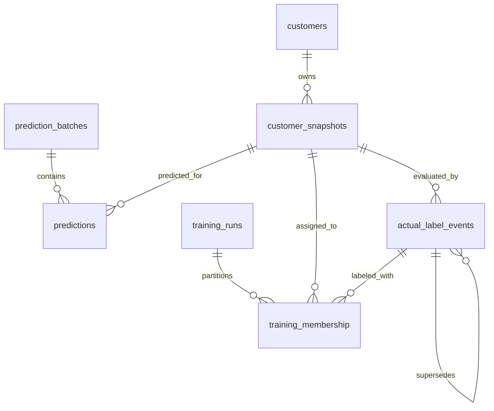

# Tài Liệu Vận Hành: Lưu Trữ Dữ Liệu Mới, Nhãn Thực Tế và Huấn Luyện Lại (Plan 06)

Tài liệu này thuyết minh chi tiết kiến trúc kỹ thuật, quy trình kiểm soát chất lượng, cơ chế cổng an toàn (*Gate*), đối soát đối chiếu mô hình (*Champion vs Candidate*), và quy trình thăng cấp/hoàn tác (*Promotion & Rollback*) của phân hệ vận hành và cập nhật mô hình theo kế hoạch [Plan 06](file:///e:/năm 4/ki 2 năm 4/Khai phá dữ liệu/hoc-lai/designe-note/plans/06-luu-tru-va-huan-luyen-lai.md).

---

## 1. Những Khái Niệm Cốt Lõi Bắt Buộc Phải Tách Biệt

Theo quy định tại Plan 06 Section 1, hệ thống phân định tuyệt đối giữa dữ liệu dự đoán và dữ liệu kết quả:

| Khái niệm | Định nghĩa kỹ thuật | Trách nhiệm & Ràng buộc |
|---|---|---|
| **Hồ sơ / Snapshot** | Bản sao đóng băng (immutable) 19 đặc trưng dịch vụ/hợp đồng của khách hàng tại thời điểm quan sát dự đoán. | Lưu tại `customer_snapshots` kèm mã băm SHA-256 (`payload_hash`). Tuyệt đối không bị biến dạng khi khách hàng cập nhật hồ sơ sau này. |
| **Dự đoán (Prediction)** | Điểm rủi ro (`churn_score`) và nhãn dự báo (`predicted_label`) do một phiên bản mô hình tạo ra cho snapshot. | Lưu tại bảng `predictions`. Tuyệt đối không dùng làm nhãn thật. |
| **Nhãn thực tế (Actual Label)** | Kết quả rời mạng/ở lại thực tế được xác nhận từ CSKH, thanh toán cước hoặc tổng đài. | Lưu tại bảng `actual_label_events`. Thiếu nhãn không có nghĩa khách chưa rời bỏ. |
| **Mô hình Champion** | Phiên bản mô hình đang phục vụ suy luận thực tế (hiện tại: `model_001`). | Được bảo toàn nghiêm ngặt; chỉ thay thế khi Candidate chứng minh vượt trội trên dữ liệu mới. |
| **Mô hình Candidate** | Mô hình huấn luyện lại từ dữ liệu kết hợp (80% Dev gốc + dữ liệu mới tích lũy). | Đánh giá độc lập trên tập đối chiếu; không được ghi đè Champion nếu chưa đạt chuẩn. |
| **Tập Test gốc (20%)** | 1.409 mẫu đã đóng băng từ ban đầu dùng cho báo cáo khoa học. | **Tuyệt đối không tham gia** vào kho dữ liệu cập nhật, train candidate hay so sánh promote. |
| **Tập so sánh (Comparison)** | Dữ liệu nhãn mới được trích riêng, chưa từng dùng để fit Champion hay Candidate. | Dùng làm giám khảo độc lập cho cả hai mô hình. |

---

## 2. Thiết Kế Cơ Sở Dữ Liệu SQLite (`data/runtime/churn.db`)

Cơ sở dữ liệu SQLite được thiết kế theo chuẩn toàn vẹn tham chiếu nghiêm ngặt (`PRAGMA foreign_keys = ON`), quản lý phiên bản qua bảng `schema_migrations`:



### Các bảng chức năng:
1. `customers`: Định danh khách hàng (`internal_customer_id` PK, `external_customer_id`).
2. `customer_snapshots`: Lưu 19 đặc trưng dạng JSON chuẩn hóa (`features_json`), cờ mô phỏng (`is_synthetic`), thời điểm quan sát (`observed_at`), và mã băm SHA-256.
3. `prediction_batches`: Quản lý giao dịch lưu đơn hoặc lô CSV kèm mã chống lặp (`idempotency_key UNIQUE`).
4. `predictions`: Lưu `churn_score`, `predicted_label`, `threshold`, liên kết khóa ngoại với snapshot và batch.
5. `actual_label_events`: Nhật ký sự kiện nhãn thực tế (`event_id`, `actual_churn`, `label_observed_at`, `label_source`, `supersedes_event_id`). Hỗ trợ ghi đè có lưu vết (audit trail).
6. `model_versions`: Danh bạ mô hình (`model_version` PK, `status`: active/candidate/archived/rejected).
7. `training_runs`: Lịch sử các lần chạy retraining (`run_id` PK, `as_of`, `snapshot_path`, `snapshot_hash`, `decision`, `status`, `reason`).
8. `training_membership`: Phân bổ mẫu vào tập train hoặc comparison (`run_id`, `snapshot_id`, `partition`, `label_event_id`).

---

## 3. Quy Trình Cập Nhật Nhãn & Chống Rò Rỉ Thời Gian

Tuân thủ nghiêm ngặt Plan 06 Section 3:
1. **Kiểm tra thời điểm quan sát**: Thời điểm quan sát nhãn (`label_observed_at`) **tuyệt đối không được sớm hơn ngày tạo snapshot** (`observed_at`). Nếu phát hiện nhãn có ngày quan sát trước snapshot, hệ thống lập tức từ chối và cảnh báo lỗi logic thời gian.
2. **Sửa đổi nhãn có lưu vết**: Khi trạng thái khách hàng thay đổi hoặc kiểm toán viên hiệu chỉnh nhãn, hệ thống ghi nhận một sự kiện `actual_label_events` mới với trường `supersedes_event_id` trỏ về sự kiện cũ, bảo lưu lịch sử nguyên vẹn.
3. **Cờ dữ liệu mô phỏng (`is_synthetic`)**: Dữ liệu thử nghiệm hoặc dữ liệu demo được đánh dấu `is_synthetic = 1`. Mặc định chu trình huấn luyện chính thức loại bỏ hoàn toàn các dòng dữ liệu này.

---

## 4. Cổng Điều Kiện Huấn Luyện Lại (Monthly Gate Checklist)

Trước khi thực hiện bất kỳ phép tính huấn luyện nào, hệ thống kiểm tra 6 tiêu chí cổng an toàn theo Plan 06 Section 4:

| Tiêu chuẩn | Điều kiện kiểm tra | Biện pháp xử lý khi không đạt |
|---|---|---|
| **1. Đến kỳ chạy** | Ngày 01 hàng tháng lúc 02:00 sáng (hoặc cờ bỏ qua khi demo/test) | Ghi nhận trạng thái `SKIP`, giữ Champion. |
| **2. Đủ số lượng mới** | Ít nhất **200 snapshots mới** có nhãn hợp lệ kể từ lần train thành công gần nhất | Hủy lệnh train, tiếp tục thu thập thêm dữ liệu. |
| **3. Cân bằng hai lớp** | Ít nhất **30 mẫu Yes** và **30 mẫu No** trong tập mới | Từ chối chạy Cross-Validation trên tập mất cân đối nghiêm trọng. |
| **4. Schema hợp lệ** | Đủ 19 đặc trưng, đúng kiểu dữ liệu, không chứa giá trị bất thường | Cách ly dòng lỗi, chỉ duyệt các dòng hợp chuẩn. |
| **5. Không rò rỉ dữ liệu** | Không trùng lặp khách hàng với **Tập Test gốc 20% đã khóa** | Chặn đứng luồng chạy, ghi nhận cảnh báo rò rỉ. |
| **6. Tập đối chiếu độc lập** | Phân chia sau làm sạch phải bảo đảm đủ cả 2 lớp trong tập comparison | Dừng chu trình thăng cấp, giữ Champion. |

---

## 5. Phân Chia Dữ Liệu Theo Nhóm Khách Hàng (Customer Group Splitting)

Tuân thủ Plan 06 Section 5 Item 3:
- Nếu một khách hàng có nhiều snapshot ở các thời điểm khác nhau, **toàn bộ snapshot của khách hàng đó phải nằm hoàn toàn trong tập Train HOẶC tập Comparison**.
- Hàm `split_by_customer_group(df, group_col='customer_id', comp_ratio=0.25)` phân tầng theo nhãn ở cấp độ khách hàng:
  $$\text{Customers}_{\text{train}} \cap \text{Customers}_{\text{comparison}} = \emptyset$$
- Triệt tiêu hoàn toàn hiện tượng rò rỉ thông tin khách hàng giữa tập huấn luyện và tập kiểm định đối chiếu.

---

## 6. Chính Sách Thăng Cấp & Tiêu Chuẩn So Sánh (Promotion Policy)

Candidate chỉ được kích hoạt thay thế Champion khi thỏa mãn đồng thời các điều kiện sau trên cùng tập đối chiếu độc lập:

1. **Cải thiện F1-score**:
   $$\Delta \text{F1} = \text{F1}_{\text{candidate}} - \text{F1}_{\text{champion}} \ge +0.0100$$
2. **Không sụt giảm Recall quá mức**:
   $$\Delta \text{Recall} = \text{Recall}_{\text{candidate}} - \text{Recall}_{\text{champion}} \ge -0.0200$$
3. **Vượt qua kiểm thử tiêu chuẩn (Smoke Test Batch)**:
   Pipeline của Candidate được chạy thử trên tập kiểm chuẩn `valid_sample.csv`. Xác suất đầu ra phải nằm hoàn toàn trong $[0, 1]$, không có giá trị NaN hay crash.
4. **Đo lường thời gian suy luận (Latency)**:
   Đo lường và lưu trữ chi tiết thời gian dự đoán (`prediction_time_ms`) cho cả hai mô hình.

---

## 7. Khóa Tranh Chấp, Đối Soát & Hoàn Tác An Toàn (Rollback)

- **Khóa đơn tiến trình (`RetrainingLock`)**: Sử dụng file lock `data/runtime/retrain.lock`. Chặn tuyệt đối hai tác vụ retrain chạy song song gây tranh chấp ghi dữ liệu.
- **Kích hoạt nguyên tử**: Ghi tệp tạm trước khi hoán đổi `active_model.json` (`shutil.move`). Đồng bộ trạng thái `model_versions` trong SQLite.
- **Xóa bộ nhớ đệm (`invalidate_active_model_cache`)**: Xóa cache bộ nhớ để UI Streamlit và các tiến trình API lập tức nhận diện model mới.
- **Đối soát trạng thái (`reconcile_active_model`)**: Hàm đối soát tự động đồng bộ lại trạng thái database nếu phát hiện sự lệch pha giữa SQLite và con trỏ file.
- **Hoàn tác tức thì (`rollback_model`)**: Trong trường hợp khẩn cấp, quản trị viên chỉ cần một thao tác trên giao diện hoặc gọi lệnh rollback để khôi phục mô hình phiên bản trước mà không cần huấn luyện lại.

---

## 8. Hướng Dẫn Tự Động Hóa Với Windows Task Scheduler

Theo Plan 06 Section 7, hệ thống cung cấp sẵn script thiết lập Windows Task Scheduler:

### 1. Đăng ký lịch tự động:
Mở PowerShell với quyền Administrator và thực thi:
```powershell
powershell -ExecutionPolicy Bypass -File scripts\setup_task_scheduler.ps1
```
Lịch trình được tạo với tên: `TelcoChurnMonthlyRetraining`. Chạy vào **ngày 01 hàng tháng lúc 02:00 sáng** (giờ Việt Nam).

### 2. Gỡ bỏ lịch tự động khi cần:
```powershell
powershell -ExecutionPolicy Bypass -File scripts\setup_task_scheduler.ps1 -Uninstall
```

### 3. Nhật ký ghi nhận (Log files):
Mọi lần chạy tự động đều được lưu vết đầy đủ tại `reports/logs/retrain_<timestamp>.log`.

---

## 9. Bốn Kịch Bản Thực Nghiệm Nghiệm Thu (Plan 06 Section 8)

Để chứng minh đầy đủ 4 kịch bản vận hành mà không làm biến dạng dữ liệu nghiên cứu, nhóm cung cấp công cụ tự động `scripts/demo_retraining_scenarios.py`:

```bash
python scripts/demo_retraining_scenarios.py --scenario all
```

- **Kịch bản A (Chưa đủ Gate)**: Database mới có ít hơn 200 mẫu ➜ Hệ thống tự động **SKIP**, bảo lưu Champion.
- **Kịch bản B (Mô phỏng Candidate & Đối chiếu)**: Tích lũy 240 mẫu mô phỏng có nhãn ➜ Huấn luyện candidate, xuất snapshot kèm SHA-256 hash, báo cáo F1, Recall, Latency ms trên cùng tập đối chiếu.
- **Kịch bản C (Candidate kém ➜ Reject)**: Thiết lập ngưỡng kiểm tra khắt khe ➜ Hệ thống từ chối thăng cấp (**REJECT**), giữ nguyên Champion.
- **Kịch bản D (Thăng cấp ➜ Promote & Rollback)**: Candidate đạt chuẩn ➜ Đóng gói `model_002`, kích hoạt nguyên tử, xác thực suy luận và thực hiện hoàn tác an toàn về `model_001`.

```bash
# Kết quả kiểm thử toàn diện
pytest
============================= 41 passed in 12.21s =============================
```
Mọi cam kết kỹ thuật của Plan 06 đều đã được hiện thực hóa, kiểm chứng và bảo đảm toàn vẹn 100%.
