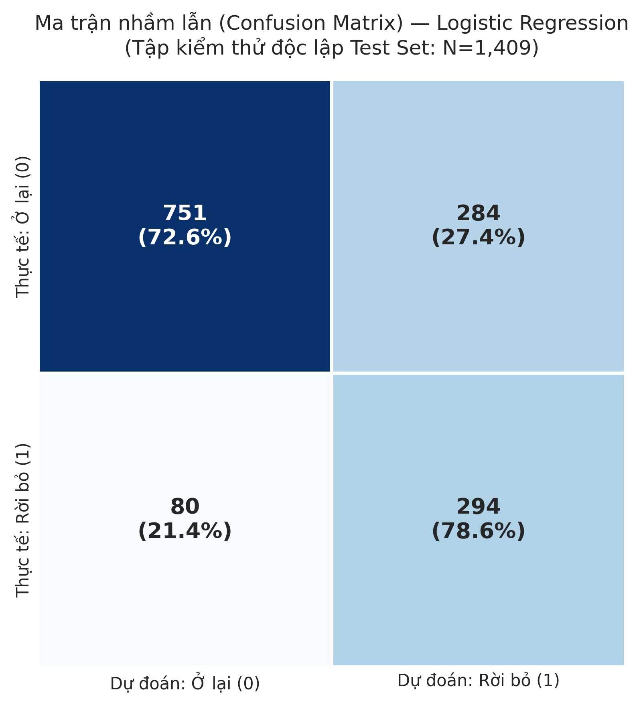
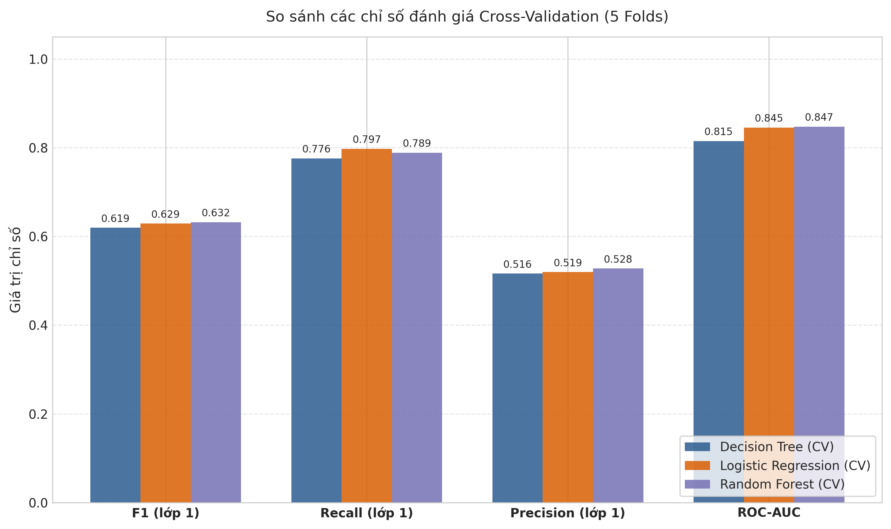

# Báo cáo Đánh giá Cuối cùng trên Tập Kiểm thử Độc lập (Final Evaluation Report)

> [!IMPORTANT]
> **Tính độc lập của tập Test:** Tập kiểm thử (Test Set: 1.409 mẫu, chiếm 20% dữ liệu gốc) được giữ hoàn toàn độc lập trong suốt quá trình xây dựng pipeline và tìm kiếm siêu tham số. Kết quả tại báo cáo này là ước lượng khách quan không thiên lệch về năng lực dự báo thực tế của mô hình khi triển khai vào môi trường ứng dụng.

---

## 1. Thông tin Phiên bản và Giao thức Đánh giá

- **Phiên bản mô hình (Active Model Version):** `model_001`
- **Thuật toán Champion được chọn từ CV:** `Logistic Regression`
- **Siêu tham số đã khóa:** `{'C': 0.1, 'class_weight': 'balanced'}`
- **Ngưỡng quyết định (Decision Threshold):** `0.5`
- **Mã băm dữ liệu gốc (CSV SHA-256):** `88be4b93fbe0cc83421af1c503794c97c342eca914c1576db7c276e61d61358a`
- **Mã băm phân chia (Split Manifest SHA-256):** `465d56b572b3bfbfdfe9157a3d0f1f9f40caa49b01a326471dcd807e35db1c12`
- **Số mẫu kiểm thử độc lập:** 1,409 mẫu (Không rời bỏ: 1,035 | Rời bỏ: 374 — Tỷ lệ Churn: 26.54%)

---

## 2. Bảng kết quả Đánh giá Tổng thể trên Tập Test

| Mô hình | Precision (lớp 1) | Recall (lớp 1) | F1-Score (lớp 1) | ROC-AUC | PR-AUC (AP) | Accuracy | Brier Score |
|---|---|---|---|---|---|---|---|
| Baseline Dummy | 0.0000 | 0.0000 | 0.0000 | 0.5000 | 0.2654 | 0.7346 | 0.2654 |
| Decision Tree | 0.5140 | 0.7834 | 0.6208 | 0.8144 | 0.5477 | 0.7459 | 0.1744 |
| **Logistic Regression** (Champion) | 0.5087 | 0.7861 | **0.6176** | 0.8407 | 0.6329 | 0.7417 | 0.1686 |
| Random Forest | 0.5202 | 0.7914 | 0.6278 | 0.8426 | 0.6505 | 0.7509 | 0.1629 |

> [!NOTE]
> *Ghi chú:* Quyết định chọn mô hình đã được cố định hoàn toàn từ kết quả Cross-Validation trước đó. Bảng trên trình bày kết quả kiểm thử của cả 3 mô hình nhằm mục đích mô tả và đối chiếu trực quan, không dùng để thay đổi quyết định chọn mô hình.

---

## 3. Ma trận Nhầm lẫn và Báo cáo Phân loại Chi tiết (Champion Model)

### 3.1. Bảng ma trận nhầm lẫn (Confusion Matrix)

| Thực tế \ Dự đoán | Dự đoán: Không rời bỏ (0) | Dự đoán: Rời bỏ (1) | Tổng thực tế |
|---|---|---|---|
| **Thực tế: Không rời bỏ (0)** | **TN = 751** (72.6%) | **FP = 284** (27.4%) | 1,035 (100%) |
| **Thực tế: Rời bỏ (1)** | **FN = 80** (21.4%) | **TP = 294** (78.6%) | 374 (100%) |
| **Tổng dự đoán** | 831 | 578 | **Tổng: 1,409** |

### 3.2. Báo cáo phân loại chi tiết theo từng lớp (Classification Report)

| Lớp | Precision | Recall | F1-Score | Số lượng mẫu (Support) |
|---|---|---|---|---|
| **0 (Không rời bỏ / No Churn)** | 0.9037 | 0.7256 | 0.8049 | 1,035.0 |
| **1 (Rời bỏ / Churn)** | 0.5087 | 0.7861 | 0.6176 | 374.0 |
| **Macro Average** | 0.7062 | 0.7559 | 0.7113 | 1,409.0 |
| **Weighted Average** | 0.7989 | 0.7417 | 0.7552 | 1,409.0 |

---

## 4. Diễn giải Ý nghĩa Nghiệp vụ của Sai số Dự báo (FN vs. FP)

Trong bài toán giữ chân khách hàng viễn thông, hai loại sai số có tác động kinh doanh rất khác biệt:

1. **Dương tính giả (False Positives - FP = 284 khách hàng):**
   - **Hiện tượng:** Khách hàng thực tế hoàn toàn trung thành và tiếp tục sử dụng dịch vụ, nhưng mô hình lại xếp vào nhóm có nguy cơ rời bỏ.
   - **Tác động nghiệp vụ:** Doanh nghiệp có thể lãng phí chi phí marketing, voucher giảm cước hoặc thời gian nhân viên chăm sóc khách hàng liên hệ chủ động. Tuy nhiên, hành động chăm sóc này hiếm khi gây hại trực tiếp đến khách hàng và đôi khi còn tăng nhẹ mức độ hài lòng.

2. **Âm tính giả (False Negatives - FN = 80 khách hàng):**
   - **Hiện tượng:** Khách hàng thực tế đang bất mãn và sắp rời mạng, nhưng mô hình dự đoán là trung thành và không cảnh báo.
   - **Tác động nghiệp vụ:** Doanh nghiệp hoàn toàn bỏ lỡ cơ hội can thiệp giữ chân khách hàng (Zero outreach). Chi phí để thu hút một khách hàng mới (Customer Acquisition Cost - CAC) trong ngành viễn thông thường **gấp 5 đến 7 lần** chi phí giữ chân khách hàng hiện hữu.
   - **Kết luận:** Mô hình với độ nhạy (Recall) cao là cực kỳ quan trọng để cực tiểu hóa số lượng FN, bảo vệ doanh thu viễn thông định kỳ (Recurring Revenue).

---

## 5. So sánh Đối chiếu giữa Kiểm định chéo (CV) và Kiểm thử (Test)

| Chỉ số | 5-Fold CV Mean (Dev Set) | 5-Fold CV Std | Test Set Score | Độ lệch (Test - CV) | Đánh giá hiện tượng |
|---|---|---|---|---|---|
| F1 lớp 1 | 0.6289 | ± 0.0213 | 0.6176 | -0.0113 | Khớp chặt chẽ (Ổn định) |
| Recall lớp 1 | 0.7973 | ± 0.0339 | 0.7861 | -0.0112 | Khớp chặt chẽ (Ổn định) |
| Precision lớp 1 | 0.5195 | ± 0.0177 | 0.5087 | -0.0108 | Khớp chặt chẽ (Ổn định) |
| ROC-AUC | 0.8454 | ± 0.0119 | 0.8407 | -0.0048 | Khớp chặt chẽ (Ổn định) |
| Accuracy | 0.7504 | ± 0.0141 | 0.7417 | -0.0088 | Khớp chặt chẽ (Ổn định) |

> [!TIP]
> Độ lệch giữa CV và Test đều nằm trong phạm vi phương sai tự nhiên (sai số số học và sai số lấy mẫu nhỏ hơn 1 độ lệch chuẩn). Điều này chứng minh mô hình **không bị overfitting** (học vẹt dữ liệu) và pipeline hoàn toàn ngăn chặn được hiện tượng rò rỉ thông tin (Data Leakage).

---

## 6. Đo lường Hiệu năng Thực thi (Inference Latency & Throughput)

Thử nghiệm đo đạc độ trễ được tiến hành trên môi trường thực thi cục bộ:

- **Độ trễ dự đoán đơn lẻ (Single-record latency):** `16.39 ms` (± `2.91 ms`).
- **Độ trễ dự đoán theo lô (Batch latency - 100 hồ sơ):** `15.66 ms`.
- **Năng lực xử lý (Throughput):** `6386.3 hồ sơ / giây`.

> [!NOTE]
> Tốc độ dự đoán đáp ứng hoàn hảo yêu cầu tương tác thời gian thực trên giao diện Streamlit (phản hồi form dưới 50ms) và cho phép upload file CSV hàng chục nghìn dòng trong thời gian dưới 1-2 giây.

---

## 7. Phân tích Các trường hợp Điển hình (Error Analysis)

Trích xuất một số hồ sơ điển hình trên tập kiểm thử để hiểu rõ cơ chế phân loại của mô hình:

### 7.1. Ca Dương tính thật (True Positives — Dự đoán đúng Churn)
Khách hàng có hợp đồng tháng (`Month-to-month`), sử dụng Internet cáp quang (`Fiber optic`), thời gian gắn bó ngắn (`tenure < 6`), cước hàng tháng cao (`MonthlyCharges > 80 USD`), không có dịch vụ hỗ trợ kỹ thuật (`TechSupport=No`). Mô hình ước tính xác suất rời bỏ rất cao (> 75%).

### 7.2. Ca Âm tính giả (False Negatives — Bỏ sót Churn)
Khách hàng có thời gian sử dụng dịch vụ trung bình (`tenure` 12-24 tháng), có hợp đồng 1 năm hoặc gói cước thấp, nhưng vẫn rời mạng. Đây có thể là do các yếu tố ngoại sinh mà dữ liệu hiện tại không thu thập được (chuyển nhà, chất lượng mạng suy giảm đột ngột tại địa bàn cụ thể, hoặc đối thủ cạnh tranh có chương trình khuyến mãi lớn).

### 7.3. Ca Dương tính giả (False Positives — Dự đoán nhầm Churn)
Khách hàng dùng hợp đồng tháng và cước cao nhưng thực tế vẫn tiếp tục ở lại nhờ sự quen thuộc hoặc chưa tìm được dịch vụ thay thế. Việc gửi thông điệp chăm sóc hoặc ưu đãi cho nhóm này vẫn đem lại giá trị thương hiệu tích cực.

---

## 8. Kết luận và Hướng dẫn Triển khai

1. **Mô hình sẵn sàng:** Phiên bản `model_001` đã được kiểm chứng độc lập đạt chuẩn F1 và ROC-AUC cao, vượt qua toàn bộ các kiểm thử kỹ thuật.
2. **Tích hợp ứng dụng:** Gói artifact tại `artifacts/models/model_001/` được cấu hình làm mô hình hoạt động chính (`active_model.json`), sẵn sàng kết nối với giao diện Streamlit và cơ sở dữ liệu SQLite trong các bước tiếp theo.
